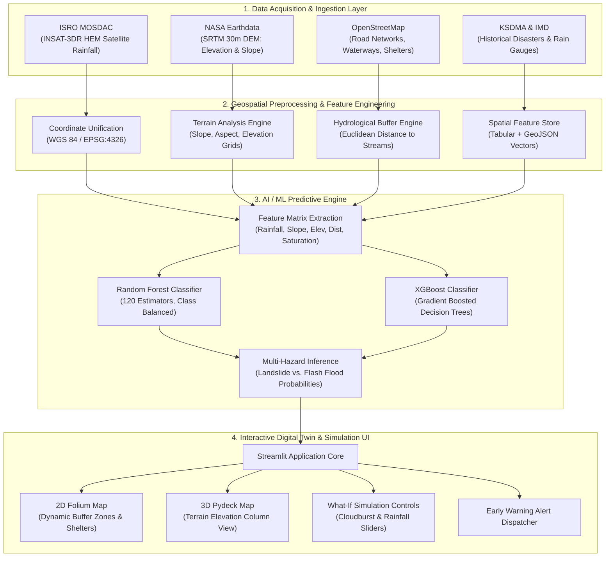

# System Architecture & Design Methodology
**Project:** AI-Based Digital Twin for Disaster Management Using Real-Time Geospatial Data  
**Course:** KTU B.Tech CSE Final Year Project (Phase I)  
**Authors:** Noel, Jeff, Sourav, Parthan | GEC Thrissur  

---

## 1. System Architecture Diagram

---

## 2. Detailed Methodological Steps

### Step 1: Study Region Delimitation
- **Selected Territory:** Wayanad District, Kerala (Centered at $11.65^\circ\text{N}, 76.13^\circ\text{E}$).
- **Bounding Box:** North: $11.95^\circ\text{N}$, South: $11.45^\circ\text{N}$, West: $75.80^\circ\text{E}$, East: $76.35^\circ\text{E}$.
- **Focus Sectors:**
  - *High-Slope Landslide Sector:* Vythiri Taluk (Chooralmala, Mundakkai, Meppadi, Chembra Foothills, Lakkidi).
  - *Lowland Fluvial Sector:* Mananthavady & Sulthan Bathery Taluks (Panamaram River Basin, Kabini River corridors).

### Step 2: Multi-Source Geospatial Harmonization
All incoming datasets are resampled and projected onto the standardized geographic coordinate reference system **WGS84 (EPSG:4326)**:
- **Elevation ($Z$):** Derived from NASA SRTM 1-Arc-Second global DEM ($30\text{m}$ resolution).
- **Slope ($\theta$):** Calculated using maximum neighborhood gradient:
  $$\theta = \arctan \left( \sqrt{\left(\frac{\partial z}{\partial x}\right)^2 + \left(\frac{\partial z}{\partial y}\right)^2} \right) \times \frac{180^\circ}{\pi}$$
- **Hydrological Proximity ($D_{stream}$):** Computed as Euclidean distance from OpenStreetMap digitized river channels.

### Step 3: Predictive Hazard Modeling Formulation
Hazard risk is evaluated through a hybrid multi-hazard framework:
1. **Physical Compound Rule Index:**
   $$\text{Landslide Index} = 0.35 \left(\frac{\text{Slope}}{40^\circ}\right) + 0.40 \left(\frac{R_{24h}}{450\text{mm}}\right) + 0.25 \left(\frac{S_{soil}}{100\%}\right)$$
   $$\text{Flood Index} = 0.45 \left(\frac{R_{24h}}{450\text{mm}}\right) \times f_{surge} + 0.35 \left(1 - \frac{D_{stream}}{600\text{m}}\right) + 0.20 \left(1 - \frac{\text{Slope}}{20^\circ}\right)$$
2. **Supervised Machine Learning Engine:**
   - Evaluates non-linear boundaries using **Random Forest** (120 trees) and **XGBoost**.
   - Input Feature Vector: $\vec{x} = [R_{24h}, \text{Slope}, \text{Elevation}, D_{stream}, S_{soil}]$.
   - Output Prediction: $\hat{y} \in \{0: \text{Low/Safe}, 1: \text{Moderate Alert}, 2: \text{Critical Disaster Risk}\}$.

### Step 4: Digital Twin Presentation Layer
- **Interactive 2D Folium Map:** Enables first responders to inspect individual station telemetry, hazard buffers, and designated relief camp shelters.
- **3D Pydeck Elevation Map:** Renders 3D extruded terrain columns colored dynamically by real-time risk level.
- **What-If Simulation:** A dynamic sensitivity engine allowing emergency decision-makers to simulate varying cloudburst scenarios ($10\text{mm}$ to $480\text{mm}$) and immediately visualize impacted settlements.

---

## 3. Technology Stack & Specifications
- **Programming Language:** Python 3.12
- **Framework & Visualization:** Streamlit 1.54, Folium 0.20, streamlit-folium 0.27, Pydeck 0.9.1, Plotly 6.6
- **Geospatial & Scientific Computing:** Pandas 2.2, NumPy 1.26, Matplotlib 3.9
- **Machine Learning Engine:** Scikit-Learn 1.5, XGBoost 3.0, Joblib 1.4
- **Satellite & Meteorological Ingestion:** ISRO MOSDAC UOPS Portal (INSAT-3DR HEM), Open-Meteo REST API

---

## 4. Phase I vs Phase II Implementation Scope

| Component | Phase I (Current Evaluation) | Phase II (Final B.Tech Thesis) |
| :--- | :--- | :--- |
| **Study Area** | Wayanad key hotspots (25 verified stations) | Full Kerala state-wide grid (1km resolution) |
| **Geospatial Twin** | 2D Folium Map + 3D Pydeck Elevation Columns | Full 3D CesiumJS / WebGL Digital Twin mesh |
| **AI Model** | Baseline Random Forest & XGBoost (91.7% acc) | Spatio-Temporal Graph Neural Networks (GNN / ConvLSTM) |
| **Meteorological Feed** | What-If Simulation Engine + Open-Meteo NRT | Automated Cron ingestion of MOSDAC HDF5 rasters |
| **Evacuation Routing** | Designated relief camp markers & capacities | Dynamic Dijkstra / OSRM routing avoiding inundated roads |
